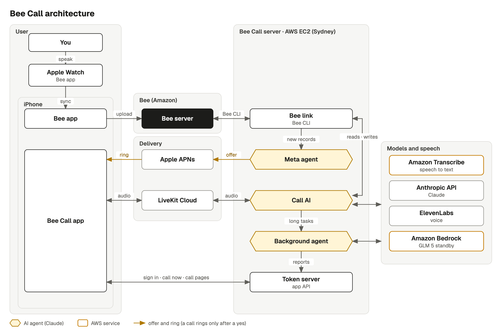

# Bee Call

Bee Call is for people who think out loud. Say a half-formed idea to your Bee wearable during the day, and Bee Call may ask, with a notification, whether you want a call about it. If you say yes, your iPhone rings right away or at the time the offer suggests. On the call, an AI talks it through with you. Longer tasks, such as research, go to a background agent so the conversation keeps going, and the AI tells you the results when they are ready. The facts and to-dos you agree to are saved back into Bee. You can also call Bee Call from the app at any time.

Demo video: https://youtu.be/Qvy9jgYbTw0

Built for the Amazon Build, Ship, Shape hackathon (Bee track).

## How it uses Bee

Bee, Amazon's wearable AI, records conversations and voice notes. Here it runs as the Bee app on an Apple Watch, and it keeps what it heard in the user's Bee account, with the facts, suggested to-dos and daily summaries it draws from it. Bee Call reaches that account only through the official Bee CLI ([`@beeai/cli`](https://www.npmjs.com/package/@beeai/cli)), with each person's own Bee login.

**What it reads.** Bee Call watches for new Bee records. Each new batch wakes the person's meta agent, which decides whether a call would help. The meta agent, the call prep (a short note the AI gets before it picks up) and the call AI read Bee through one shared set of read tools, covering today, conversations and their transcripts, search, daily summaries, facts, to-dos, voice notes and insights. Bee also hears the user's calls with Bee Call, so Bee Call leaves those lines out.

**What it writes.** During a call, the AI can add, confirm, correct or delete a fact, and add, accept, complete or dismiss a to-do. It changes Bee only after the user's clear yes to a question that named the item, or when the user clearly asked for the change. New things that came up are offered once, near the end of the call, and added together after a yes. Every write is logged with the AI's question and the user's answer, word for word.

**Undo.** When the user says "take it back", the AI undoes the change. Bee has no undelete, so a deleted fact comes back as a new item. After the call, one notification sums up what changed in Bee.

Bee Call also works without Bee, and then it reads and writes nothing there. [docs/bee.md](docs/bee.md) has the details, with the code for each part.

**For other Bee developers.** I rewrote the parts of Bee Call that talk to Bee as a separate, general Python library, [bee-agent-tools](https://github.com/leeminseung/bee-agent-tools). I also sent the Bee CLI a fix that lets `bee status` finish a `--no-wait` login once the user approves it ([bee-computer/bee-cli#26](https://github.com/bee-computer/bee-cli/pull/26)).

## Architecture



In the figure, the user talks to Bee on an Apple Watch, and the Bee app on the iPhone uploads the recording to Bee's server. On the Bee Call server, the Bee link reads new conversations and voice notes through the Bee CLI. The meta agent, which reviews each new record, decides whether a call from the AI would help. Its offer reaches the Bee Call app through Apple's push service, and nothing rings without a yes. On the call, LiveKit Cloud carries the audio between the app and the call AI, which hears through Amazon Transcribe, thinks with Claude and speaks with ElevenLabs. Longer tasks the user asks for, such as research or a comparison, go to the background agent, whose reports reach the app through the app API (the token server in the figure). When the user agrees on the call to save what came up, the call AI writes those facts and to-dos back to Bee through the Bee link.

| Part | Where it runs | What it does |
|---|---|---|
| iPhone app (`ios/BeeCall`) | the user's iPhone | Rings and answers with CallKit, joins the call's LiveKit room, and shows live captions, offers, the call list and each call's page |
| Token server (`voice/token_server.py`) | the server | The app's API. Checks Sign in with Apple, hands out LiveKit room tokens, streams rings to an open app, keeps push tokens, offers and settings, and serves the call list and each call's page (`voice/call_view.py`) |
| Voice server (`voice/agent.py`) | the server, joined to LiveKit Cloud rooms | Runs one LiveKit Agents session per call. Amazon Transcribe turns speech into text, the call AI answers, and ElevenLabs or Amazon Polly speaks. Keeps a record of every call, with the audio only while the person allows it |
| Call AI (`voice/coordinator.py`) | inside the voice server, with models on Anthropic's API | Claude Haiku 5.5 or Claude Sonnet 5.5, as each person picks. GLM 5 on Amazon Bedrock answers instead when Claude cannot. Reads Bee, starts background jobs, books calls and writes to Bee |
| Between calls (`voice/outbound.py`, `meta/agent.py`) | the server | Watches Bee, runs each person's meta agent, sends offers, and places the calls the user agreed to |
| Bee link (`beelink/`) | the server, through the Bee CLI | The Bee CLI wrapper, the watcher, the shared read tools and the logged writes |
| Background agent (`worker/`) | inside the voice server, with Claude on Anthropic's API or an Amazon Bedrock AgentCore harness | Long jobs while the call goes on, run by Claude Sonnet 5.5 with web search, page reading and code execution, or by GLM 5 in the harness. The AI tells the user the answer during the call, and the report and charts show on the call's page in the app |
| Session screen (`voice/session_server.py`, `web/`) | the server | A web page for watching a call live in a browser, with the transcript, why the AI called, and job cards. It asks for a person's sign-in token and shows only that person's calls |

In production, "the server" is one AWS EC2 instance in Sydney (`ap-southeast-2`), reached at `https://call.mslee.dev` (the app's API, not a web page). systemd runs its four processes, which are the token server, the voice server, the between-calls process and the session screen (`deploy/systemd/`), and Caddy serves them over HTTPS. For development, the same processes run on a Mac.

## Run it yourself

Run every server process on a Mac, build the iPhone app, connect Bee and make a first call.

<details>
<summary>Show the details</summary>

These steps run every server process on a Mac. Run each command from the repository root, since the processes read `.env.local` and keep their data in `data/` relative to the folder they start in.

### What you need

Each way of trying Bee Call needs a little more than the one before it.

| To try | You need |
|---|---|
| a call in text | macOS with [uv](https://docs.astral.sh/uv/), which installs Python 3.13 from `.python-version`, and an Anthropic API key |
| a spoken test call, without a phone | also a [LiveKit Cloud](https://cloud.livekit.io) project with the LiveKit CLI (`brew install livekit-cli`), an AWS account with Amazon Transcribe and Amazon Polly, and ffmpeg |
| calls on an iPhone | also Xcode 26 or later, an Apple Developer account, and an iPhone with iOS 17 or later |
| Bee, with any of these | Node.js and the Bee CLI on the machine that runs the server (`npm install -g @beeai/cli@0.7.3`, the version the server pins), and a Bee account for each person who uses it |

Two more are optional. Access to GLM 5 on Amazon Bedrock lets a call go on when Claude cannot answer it. An ElevenLabs API key with the Text to Speech permission gives calls the voices in the app's voice list, and without it every call speaks with Amazon Polly. Sydney (`ap-southeast-2`) is the default AWS region, and `deploy/iam/server-role-policy.json` lists every AWS action the server uses.

### Set up the server

```bash
git clone https://github.com/leeminseung/bee-call.git && cd bee-call
uv sync
lk cloud auth                                      # link the LiveKit CLI to your LiveKit Cloud project
lk app env -w                                      # writes the LiveKit values into .env.local
aws configure --profile bee-call                   # AWS keys stay in ~/.aws, never in this repository
python3 scripts/set_secret.py ANTHROPIC_API_KEY    # stores the key in .env.local without showing it
python3 scripts/set_secret.py ELEVENLABS_API_KEY   # optional
```

`.env.local` holds this machine's settings and keys, and git ignores it. `.env.example` is its template. A first run needs these.

- `LIVEKIT_URL`, `LIVEKIT_API_KEY` and `LIVEKIT_API_SECRET`, written by `lk app env -w`.
- `AWS_REGION` for Transcribe and Polly, and `BEDROCK_REGION` for Bedrock. Both default to `ap-southeast-2`.
- `ANTHROPIC_API_KEY`, and `ELEVENLABS_API_KEY` if you have one.

The processes use the AWS profile named by `AWS_PROFILE` when it is set, otherwise the profile `bee-call` when it exists, otherwise boto3's default chain (`voice/aws_session.py`). The deploy scripts always use `bee-call`. Before real calls, turn off the use of your content for service improvement in AWS AI services (an AI services opt-out policy in AWS Organizations), so Amazon Transcribe does not keep your voice.

Each person who uses Bee connects their own Bee account later, from the app. Their login stays in `data/bee/<id>/` (see [Approve people and connect Bee](#approve-people-and-connect-bee)).

### Try a call in text

```bash
uv run python -m voice.people add alex     # a person for use from this Mac only
COORDINATOR_LLM=anthropic uv run python -m voice.text_call alex "Hi, I just got back from a walk." "Help me plan tomorrow."
```

`voice.text_call` runs the voice server's own call with typed lines instead of speech, so it needs no LiveKit, no phone and no running server. It prints the AI's replies and leaves the call's record in `data/people/alex/`.

### Run the services

Each process reads `.env.local` once, as it starts. To use the test callers below, first add `BEE_CALL_DEV_PERSON=alex` to `.env.local`. Then start each process in its own terminal.

```bash
uv run python -m voice.token_server                                          # the app's API, port 8787
COORDINATOR_LLM=anthropic WORKER=harness uv run python -m voice.agent dev    # the voice server
COORDINATOR_LLM=anthropic uv run python -m voice.outbound                    # Bee watcher, meta agent, offers
BEE_CALL_DEV_PERSON=alex uv run python -m voice.session_server               # optional: http://localhost:8788/
```

- `COORDINATOR_LLM=anthropic` makes the call AI and the call prep use Claude on Anthropic's API, as the server does. Without it, the call AI only repeats what it hears, a stand-in for testing the audio path, and there is no prep. The meta agent and the titles after calls use Claude either way. [docs/models-and-jobs.md](docs/models-and-jobs.md) lists the other modes.
- `WORKER=harness` turns on real background jobs, run by each person's worker model. Claude Sonnet 5.5, the default, calls Anthropic's API. Only GLM 5 jobs need an Amazon Bedrock AgentCore harness, an agent loop that AWS runs, which `uv run python scripts/deploy_worker.py` creates in your account (`--smoke` also runs one test job). Without `WORKER=harness`, jobs are simulated.
- The voice server registers with LiveKit as the agent `bee-call`. When more than one machine runs against the same LiveKit project, give each its own name with `LIVEKIT_AGENT_NAME` in `.env.local`, or LiveKit splits the calls between them. Run `voice.outbound` for a Bee account on one machine only, or both would offer calls about the same Bee changes.
- The token server listens on every network interface, so an iPhone on the same Wi-Fi can reach it.
- The session screen shows a call live. It does not read `.env.local`, so give it the person whose calls to show on its command line, as above. Add `?debug=1` to its address for a switch that shows the debug events too.

For a spoken test call without a phone, run `uv run python -m voice.fake_caller --line "Hello"` while the voice server runs. Amazon Polly plays a caller into a new LiveKit room, the voice server answers, and the call is recorded as `alex`'s. `--line` repeats for more lines, and `--gap` sets the pauses before them. `COORDINATOR_LLM=anthropic uv run python -m voice.agent console` instead talks with you through the Mac's own microphone and speakers.

### Build the iPhone app

1. Open `ios/BeeCall/BeeCall.xcodeproj` and choose your team under Signing & Capabilities. The app uses Sign in with Apple, push notifications, and the audio and VoIP background modes. If you sign with your own team, give the app a bundle identifier of your own (the project uses `com.leeminseung.beecall`) and set `APNS_BUNDLE_ID` in `.env.local` to the same value. The token server checks Sign in with Apple tokens against it, and pushes are addressed to it.
2. Point the Debug build at your Mac. The app reads the token server's address from the build setting `BEE_CALL_SERVER`. For Debug builds, `ios/BeeCall/Debug.xcconfig` sets it to `http://localhost:8787`, which only the Simulator can reach. For an iPhone on the same Wi-Fi, copy the example file and put your Mac's LAN address in it.
   ```bash
   cp ios/BeeCall/Local.xcconfig.example ios/BeeCall/Local.xcconfig
   ```
   Git ignores `Local.xcconfig`. `Debug.xcconfig` reads it last, so its value wins. A Debug build's settings sheet also has a field for the token server's address.
3. Let the Debug build use your server for everything. By default, a Debug build answers the call list, offers, voices, models and its own settings sheet from the example files in `contract/examples/`. Sign-in, calls, ringing and the switches in the iOS Settings app still go to the server. Add the launch argument `-realServer YES` (Product > Scheme > Edit Scheme > Run > Arguments) to send the rest there too.
4. Run the app and sign in with Apple. A new person sees a six-character code to approve (next section).

A Release build, the one TestFlight gets, always reads from the server. It talks to `https://call.mslee.dev`, the Release value of `BEE_CALL_SERVER` in `ios/BeeCall/BeeCall.xcodeproj`. Change that value to point a Release build at your own server.

For calls to ring while the app is closed, and for offer notifications, the server needs an APNs key. Create one in the Apple Developer account (Certificates, Identifiers & Profiles, then Keys, with Apple Push Notifications service). Keep the `.p8` file outside the repository, and set `APNS_KEY_PATH`, `APNS_KEY_ID` and `APNS_TEAM_ID` in `.env.local`. Without a key, only an open app rings, and offers show only inside the app.

The app's own settings sheet holds the call language, the voice, the call and worker models, and noise cancellation. The Bee Call page of the iOS Settings app holds the evening call time (the time an offer suggests, 21:00 by default), whether call audio is saved on the server and on the iPhone, and Use Bee.

### Approve people and connect Bee

One server serves several people, each with their own folder, settings and Bee login (`voice/people.py`). A new person who signs in with Apple waits until you approve the code the app shows them.

```bash
uv run python -m voice.people waiting                       # sign-ins waiting, with their codes
uv run python -m voice.people approve 7F3C2A --as sam       # approve a code under a new short id
uv run python -m voice.people list                          # approved people and their settings
uv run python -m voice.people set sam daily_budget_usd 2    # change one setting (JSON value)
uv run python -m voice.people remove sam                    # take access away (the folder stays)
```

To connect Bee, the person turns on Use Bee in the iOS Settings app, opens Bee Call, and approves the request in the Bee app.

Each person's day has a budget, 3 USD by default. It is an estimate of what their calls, models, speech recognition, background jobs and meta agent used that day on their own clock, not AWS's bill (`voice/costs.py`). Once it is used up, new calls are refused until the next day.

For work on the Mac alone, `voice.people add alex` approves a person without Apple sign-in. With `BEE_CALL_DEV_PERSON=alex` in `.env.local`, requests made on the Mac itself act as that person when they carry the header `X-Bee-Call-Dev: 1`. The production server ignores this setting, since it runs with `BEE_CALL_PUBLIC_HOST` set. To connect that person's Bee without the app, run `curl -X POST http://localhost:8787/bee/connect -H 'X-Bee-Call-Dev: 1'` and open the link it returns on the phone with the Bee app.

### Make the first call

Once the app is signed in and approved, tap the round call button on its home screen. The app gets a LiveKit token from the token server, the voice server joins the room, and the AI picks up within a few seconds.

To see the AI ask first, make an offer by hand.

```bash
uv run python -m voice.offers ask sam --topic "Planned a Saturday hike" --reason "Sam mentioned a hike on Saturday."
```

The offer shows in the app, and as a notification once the server has an APNs key. Tap "Now" on the offer in the app, or "Call me now" on the notification, and the between-calls process places the call and the phone rings. With Bee connected, the meta agent makes such offers on its own when Bee records something worth a call.

</details>

## Deploying to AWS

The production server is one EC2 instance in Sydney, set up and updated from a Mac with `scripts/deploy_server.py`.

<details>
<summary>Show the details</summary>

The production server is one EC2 instance (`t4g.medium`, Amazon Linux 2023 on arm64) in Sydney. Caddy serves the token server on port 443 and the session screen on port 8443, with a Let's Encrypt certificate. The settings and keys from `.env.local` are kept in SSM Parameter Store under `/bee-call/` and written into memory at each boot. Nobody logs in to the instance, and every command reaches it through SSM Run Command. `deploy/install.sh` pins uv, Caddy and the Bee CLI (`@beeai/cli` 0.7.3, only its linux-arm64 binary) by sha256.

Before the first deployment, the AWS account needs an IAM role for the instance and a domain in Route 53. [deploy/README.md](deploy/README.md) gives every step in order, with what runs where on the instance and how its size was chosen. `scripts/deploy_server.py`, run on a Mac, does the rest. A command that changes AWS prints its plan first and acts only with `--yes`. These are its main commands, in the order of a first deployment. deploy/README.md adds the steps between them, such as adding the deploy key to GitHub and storing the APNs key.

```bash
uv run python scripts/deploy_server.py deploy-key --yes             # a read-only GitHub deploy key, kept in SSM
uv run python scripts/deploy_server.py secrets                      # review what would go to SSM, by name and length
uv run python scripts/deploy_server.py secrets --yes                # copy it to SSM
uv run python scripts/deploy_server.py up --yes                     # security group, instance, Elastic IP
uv run python scripts/deploy_server.py dns call.example.com --yes   # a Route 53 name and HTTPS
uv run python scripts/deploy_server.py ship --yes                   # pull main from GitHub and restart
uv run python scripts/deploy_server.py status                       # services, memory, the voice server's jobs
```

The instance clones `leeminseung/bee-call` (`REPO` in `deploy/bootstrap.sh` and `GITHUB_REPO` in `scripts/deploy_server.py`), so a fork changes those two lines first.

</details>

## Tests

The server, the session screen and the iPhone app each have their own tests.

<details>
<summary>Show the details</summary>

```bash
uv run -q pytest -q -p no:cacheprovider     # the server
node --test 'web/test/*.test.js'            # the session screen's page
uv run -q python contract/check.py          # the app contract
```

The server tests (`tests/`) take about two minutes and need no keys. They run the voice server's calls with scripted models, Bee through a fake Bee CLI (`tests/fakebee/bee`), the meta agent, offers and booked calls, sign-in and people, background jobs, and the deployment scripts. They also check the token server's answers against the contract's JSON Schemas and write `contract/examples/` from recorded calls. The web tests load the session screen's page (`web/app.js`) with recorded calls. `contract/check.py` checks that every schema in `contract/schemas/` is valid, that every example in `contract/examples/` matches its schema, and that the bodies the contract forbids are rejected.

The app's unit tests run on a Simulator, without signing. Use the name of any iPhone Simulator you have.

```bash
cd ios/BeeCall && xcodebuild -project BeeCall.xcodeproj -scheme BeeCall -configuration Debug -destination 'platform=iOS Simulator,name=iPhone 18 Pro' CODE_SIGNING_ALLOWED=NO -collect-test-diagnostics never test
```

`probes/` holds scripts that try the real models and voices, such as `probes/meta_probe.py` (how the meta agent judges three made-up moments) and `probes/voice_samples.py` (a page to compare voices). They call paid APIs.

The black-box acceptance tests are not included here. They start the token server and the session screen from a working copy and check them only through HTTP, files and operator commands.

</details>

## More documentation

- [docs/calls.md](docs/calls.md): how a call runs, from the ring to the hang-up, and how the AI sounds.
- [docs/bee.md](docs/bee.md): connecting Bee, reading it, writing to it, and undo.
- [docs/between-calls.md](docs/between-calls.md): the meta agent, offers and booked calls.
- [docs/models-and-jobs.md](docs/models-and-jobs.md): the models, the model standing by, and background jobs.
- [docs/people-and-data.md](docs/people-and-data.md): people, the daily budget, the data folder, what the app reads, and privacy.
- [contract/app-contract.md](contract/app-contract.md): every endpoint and field the iPhone app uses.
- [docs/friction-log.md](docs/friction-log.md): problems I hit with Bee and AWS while building this, each with a suggestion.
- [deploy/README.md](deploy/README.md): the server on EC2.
- [docs/testing-from-outside.md](docs/testing-from-outside.md): ways to drive and watch Bee Call without the iPhone, AWS or a real Bee, for black-box tests.

## License

MIT. See [LICENSE](LICENSE).
