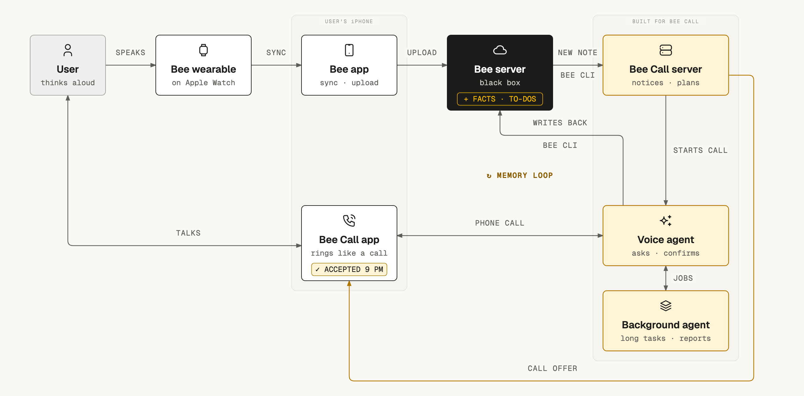

# Bee Call

Bee Call is for people who think out loud. Say a half-formed idea to your Bee wearable during the day, and Bee Call may ask, with a notification, whether you want a call about it. If you say yes, your iPhone rings right away or at the time the offer suggests. On the call, an AI talks it through with you. Longer tasks, such as research, go to a background agent so the conversation keeps going, and the AI tells you the results when they are ready. The facts and to-dos you agree to are saved back into Bee.

Demo video: [link to add]

Built for the Amazon Build, Ship, Shape hackathon (Bee track).

## How it uses Bee

Bee, Amazon's wearable AI, records conversations and voice notes. In this project it runs as the Bee app on an Apple Watch. Bee keeps what it heard in the user's Bee account, together with the facts, suggested to-dos and daily summaries it draws from it. Bee Call reaches that account only through the official Bee CLI ([`@beeai/cli`](https://www.npmjs.com/package/@beeai/cli)), with each person's own Bee login (`beelink/cli.py`).

**What it reads.** A watcher follows `bee stream` and, once a burst of changes settles, asks `bee changed` for what is new (`beelink/watcher.py`). Each new batch wakes the person's meta agent, which decides between calls whether a call would help (`meta/agent.py`). Three agents read Bee with one shared set of read tools, each tool a single Bee CLI read (`beelink/toolkit.py`). They are the meta agent, the call prep (which writes the AI a short note before it picks up) and the call AI that talks with the user. The tools cover Bee's view of today, conversations and their transcripts, search, daily summaries, facts, to-dos, voice notes and insights. Bee also hears the user's calls with Bee Call, and Bee Call leaves out what Bee made of them, since each call keeps its own record (`beelink/calls.py`). The background agent never sees Bee.

**What it writes.** During a call, the AI can add, confirm, correct or delete a fact, and add, accept, complete or dismiss a to-do (`save_to_bee` in `voice/coordinator.py`, carried out by `beelink/writer.py`). It makes a change only after the user's clear yes to a question that named the item, or when the user clearly asked for that change. Whether an answer is a clear yes is the call AI's judgment, guided by its instructions. New things that came up are offered once, at a pause or near the end of the call, and added together after a yes (`organize_bee`). If the user agrees to have the past few days organized, the meta agent adds what is worth keeping from them after the call, at most 15 items. Every write is logged in the call's `bee-writes.jsonl` with the AI's question and the user's answer, word for word.

**Undo.** When the user says "take it back", the AI undoes the change they mean (`undo_bee_write`). Bee has no undelete, so a deleted fact or a dismissed suggestion comes back as a new item. After the call, one notification says how each Bee item the call touched ended, and what to check in the Bee app.

A person can also use Bee Call without Bee. They start calls from the app, the meta agent can still offer a call after one, and nothing is read from Bee or written to it. [docs/bee.md](docs/bee.md) has the details.

**For other Bee developers.** I rewrote the parts of Bee Call that talk to Bee (the Bee CLI wrapper, the watcher, the read tools and the logged writes) as a separate, general Python library with tests of its own, [bee-agent-tools](https://github.com/leeminseung/bee-agent-tools). Bee Call keeps its own versions and does not depend on it. I also sent the Bee CLI a fix that lets `bee status` finish a `--no-wait` login once it is approved ([bee-computer/bee-cli#26](https://github.com/bee-computer/bee-cli/pull/26)).

## Architecture



In the figure, the user speaks to Bee on an Apple Watch, and Bee's apps upload what it heard to Bee's server. The "Bee Call server" box is the between-calls process in the table below. It reads new notes through the Bee CLI and, when a call would help, sends the Bee Call app an offer. Once the user accepts, the app rings like a phone call. The "Voice agent" box is the voice server with its call AI. It talks with the user, hands long tasks to the background agent, and writes facts and to-dos back to Bee through the Bee CLI.

| Part | Where it runs | What it does |
|---|---|---|
| iPhone app (`ios/BeeCall`) | the user's iPhone | Rings and answers with CallKit, joins the call's LiveKit room, and shows live captions, offers, the call list and each call's page |
| Token server (`voice/token_server.py`) | the server | The app's API. Checks Sign in with Apple, hands out LiveKit room tokens, streams rings to an open app, keeps push tokens, offers and settings, and serves the call list and each call's page (`voice/call_view.py`) |
| Voice server (`voice/agent.py`) | the server, joined to LiveKit Cloud rooms | Runs one LiveKit Agents session per call. Amazon Transcribe turns speech into text, the call AI answers, and ElevenLabs or Amazon Polly speaks. Keeps a record of every call, with the audio only while the person allows it |
| Call AI (`voice/coordinator.py`) | inside the voice server, with models on Anthropic's API | Claude Haiku 5.5 or Claude Sonnet 5.5, as each person picks. GLM 5 on Amazon Bedrock answers instead when Claude cannot. Reads Bee, starts background jobs, books calls and writes to Bee |
| Between calls (`voice/outbound.py`, `meta/agent.py`) | the server | Watches Bee, runs each person's meta agent, sends offers, and places the calls the user agreed to |
| Bee link (`beelink/`) | the server, through the Bee CLI | The Bee CLI wrapper, the watcher, the shared read tools and the logged writes |
| Background agent (`worker/`) | inside the voice server, with Claude on Anthropic's API or an Amazon Bedrock AgentCore harness | Long jobs while the call goes on, run by Claude Sonnet 5.5 with web search, page reading and code execution, or by GLM 5 in the harness. The AI tells the user the answer during the call, and the report and charts show on the call's page in the app |
| Session screen (`voice/session_server.py`, `web/`) | the server | A web page for watching a call live in a browser, with the transcript, why the AI called, and job cards. It asks for a person's sign-in token and shows only that person's calls |

In production, "the server" is one AWS EC2 instance in Sydney (`ap-southeast-2`), reached at `https://call.mslee.dev` (the app's API, not a web page). systemd runs its four processes, which are the token server, the voice server, the between-calls process and the session screen (`deploy/systemd/`), and Caddy serves them over HTTPS. For development, the same processes run on a Mac.

## Run it yourself

These steps run every server process on a Mac. Run each command from the repository root, since the processes read `.env.local` and keep their data in `data/` relative to the folder they start in.

### What you need

Each way of trying Bee Call needs a little more than the one before it.

| To try | You need |
|---|---|
| a call in text | macOS with [uv](https://docs.astral.sh/uv/), which installs Python 3.13 from `.python-version`, and an Anthropic API key |
| a spoken test call, without a phone | also a [LiveKit Cloud](https://cloud.livekit.io) project with the LiveKit CLI (`brew install livekit-cli`), an AWS account with Amazon Transcribe and Amazon Polly, and ffmpeg |
| calls on an iPhone | also Xcode 26 or later, an Apple Developer account, and an iPhone with iOS 17 or later |
| Bee, with any of these | Node.js and the Bee CLI on the machine that runs the server (`npm install -g @beeai/cli@0.7.3`, the version the server pins), and a Bee account for each person who uses it |

Two more are optional. Access to GLM 5 on Amazon Bedrock lets a call go on when Claude cannot answer it. An ElevenLabs API key with the Text to Speech permission gives calls the voices in the app's voice list, and without it every call speaks with Amazon Polly. Sydney (`ap-southeast-2`) is the default AWS region, and `deploy/iam/server-role-policy.json` lists every AWS action the server uses.

### Set up the server

```bash
git clone https://github.com/leeminseung/bee-call.git && cd bee-call
uv sync
lk cloud auth                                      # link the LiveKit CLI to your LiveKit Cloud project
lk app env -w                                      # writes the LiveKit values into .env.local
aws configure --profile bee-call                   # AWS keys stay in ~/.aws, never in this repository
python3 scripts/set_secret.py ANTHROPIC_API_KEY    # stores the key in .env.local without showing it
python3 scripts/set_secret.py ELEVENLABS_API_KEY   # optional
```

`.env.local` holds this machine's settings and keys, and git ignores it. `.env.example` is its template. A first run needs these.

- `LIVEKIT_URL`, `LIVEKIT_API_KEY` and `LIVEKIT_API_SECRET`, written by `lk app env -w`.
- `AWS_REGION` for Transcribe and Polly, and `BEDROCK_REGION` for Bedrock. Both default to `ap-southeast-2`.
- `ANTHROPIC_API_KEY`, and `ELEVENLABS_API_KEY` if you have one.

The processes use the AWS profile named by `AWS_PROFILE` when it is set, otherwise the profile `bee-call` when it exists, otherwise boto3's default chain (`voice/aws_session.py`). The deploy scripts always use `bee-call`. Before real calls, turn off the use of your content for service improvement in AWS AI services (an AI services opt-out policy in AWS Organizations), so Amazon Transcribe does not keep your voice.

Each person who uses Bee connects their own Bee account later, from the app. Their login stays in `data/bee/<id>/` (see [Approve people and connect Bee](#approve-people-and-connect-bee)).

### Try a call in text

```bash
uv run python -m voice.people add alex     # a person for use from this Mac only
COORDINATOR_LLM=anthropic uv run python -m voice.text_call alex "Hi, I just got back from a walk." "Help me plan tomorrow."
```

`voice.text_call` runs the voice server's own call with typed lines instead of speech, so it needs no LiveKit, no phone and no running server. It prints the AI's replies and leaves the call's record in `data/people/alex/`.

### Run the services

Each process reads `.env.local` once, as it starts. To use the test callers below, first add `BEE_CALL_DEV_PERSON=alex` to `.env.local`. Then start each process in its own terminal.

```bash
uv run python -m voice.token_server                                          # the app's API, port 8787
COORDINATOR_LLM=anthropic WORKER=harness uv run python -m voice.agent dev    # the voice server
COORDINATOR_LLM=anthropic uv run python -m voice.outbound                    # Bee watcher, meta agent, offers
BEE_CALL_DEV_PERSON=alex uv run python -m voice.session_server               # optional: http://localhost:8788/
```

- `COORDINATOR_LLM=anthropic` makes the call AI and the call prep use Claude on Anthropic's API, as the server does. Without it, the call AI only repeats what it hears, a stand-in for testing the audio path, and there is no prep. The meta agent and the titles after calls use Claude either way. [docs/models-and-jobs.md](docs/models-and-jobs.md) lists the other modes.
- `WORKER=harness` turns on real background jobs, run by each person's worker model. Claude Sonnet 5.5, the default, calls Anthropic's API. Only GLM 5 jobs need an Amazon Bedrock AgentCore harness, an agent loop that AWS runs, which `uv run python scripts/deploy_worker.py` creates in your account (`--smoke` also runs one test job). Without `WORKER=harness`, jobs are simulated.
- The voice server registers with LiveKit as the agent `bee-call`. When more than one machine runs against the same LiveKit project, give each its own name with `LIVEKIT_AGENT_NAME` in `.env.local`, or LiveKit splits the calls between them. Run `voice.outbound` for a Bee account on one machine only, or both would offer calls about the same Bee changes.
- The token server listens on every network interface, so an iPhone on the same Wi-Fi can reach it.
- The session screen shows a call live. It does not read `.env.local`, so give it the person whose calls to show on its command line, as above. Add `?debug=1` to its address for a switch that shows the debug events too.

For a spoken test call without a phone, run `uv run python -m voice.fake_caller --line "Hello"` while the voice server runs. Amazon Polly plays a caller into a new LiveKit room, the voice server answers, and the call is recorded as `alex`'s. `--line` repeats for more lines, and `--gap` sets the pauses before them. `COORDINATOR_LLM=anthropic uv run python -m voice.agent console` instead talks with you through the Mac's own microphone and speakers.

### Build the iPhone app

1. Open `ios/BeeCall/BeeCall.xcodeproj` and choose your team under Signing & Capabilities. The app uses Sign in with Apple, push notifications, and the audio and VoIP background modes. If you sign with your own team, give the app a bundle identifier of your own (the project uses `com.leeminseung.beecall`) and set `APNS_BUNDLE_ID` in `.env.local` to the same value. The token server checks Sign in with Apple tokens against it, and pushes are addressed to it.
2. Point the Debug build at your Mac. The app reads the token server's address from the build setting `BEE_CALL_SERVER`. For Debug builds, `ios/BeeCall/Debug.xcconfig` sets it to `http://localhost:8787`, which only the Simulator can reach. For an iPhone on the same Wi-Fi, copy the example file and put your Mac's LAN address in it.
   ```bash
   cp ios/BeeCall/Local.xcconfig.example ios/BeeCall/Local.xcconfig
   ```
   Git ignores `Local.xcconfig`. `Debug.xcconfig` reads it last, so its value wins. A Debug build's settings sheet also has a field for the token server's address.
3. Let the Debug build use your server for everything. By default, a Debug build answers the call list, offers, voices, models and its own settings sheet from the example files in `contract/examples/`. Sign-in, calls, ringing and the switches in the iOS Settings app still go to the server. Add the launch argument `-realServer YES` (Product > Scheme > Edit Scheme > Run > Arguments) to send the rest there too.
4. Run the app and sign in with Apple. A new person sees a six-character code to approve (next section).

A Release build, the one TestFlight gets, always reads from the server. It talks to `https://call.mslee.dev`, the Release value of `BEE_CALL_SERVER` in `ios/BeeCall/BeeCall.xcodeproj`. Change that value to point a Release build at your own server.

For calls to ring while the app is closed, and for offer notifications, the server needs an APNs key. Create one in the Apple Developer account (Certificates, Identifiers & Profiles, then Keys, with Apple Push Notifications service). Keep the `.p8` file outside the repository, and set `APNS_KEY_PATH`, `APNS_KEY_ID` and `APNS_TEAM_ID` in `.env.local`. Without a key, only an open app rings, and offers show only inside the app.

The app's own settings sheet holds the call language, the voice, the call and worker models, and noise cancellation. The Bee Call page of the iOS Settings app holds the evening call time (the time an offer suggests, 21:00 by default), whether call audio is saved on the server and on the iPhone, and Use Bee.

### Approve people and connect Bee

One server serves several people, each with their own folder, settings and Bee login (`voice/people.py`). A new person who signs in with Apple waits until you approve the code the app shows them.

```bash
uv run python -m voice.people waiting                       # sign-ins waiting, with their codes
uv run python -m voice.people approve 7F3C2A --as sam       # approve a code under a new short id
uv run python -m voice.people list                          # approved people and their settings
uv run python -m voice.people set sam daily_budget_usd 2    # change one setting (JSON value)
uv run python -m voice.people remove sam                    # take access away (the folder stays)
```

To connect Bee, the person turns on Use Bee in the iOS Settings app, opens Bee Call, and approves the request in the Bee app.

Each person's day has a budget, 3 USD by default. It is an estimate of what their calls, models, speech recognition, background jobs and meta agent used that day on their own clock, not AWS's bill (`voice/costs.py`). Once it is used up, new calls are refused until the next day.

For work on the Mac alone, `voice.people add alex` approves a person without Apple sign-in. With `BEE_CALL_DEV_PERSON=alex` in `.env.local`, requests made on the Mac itself act as that person when they carry the header `X-Bee-Call-Dev: 1`. The production server ignores this setting, since it runs with `BEE_CALL_PUBLIC_HOST` set. To connect that person's Bee without the app, run `curl -X POST http://localhost:8787/bee/connect -H 'X-Bee-Call-Dev: 1'` and open the link it returns on the phone with the Bee app.

### Make the first call

Once the app is signed in and approved, tap the round call button on its home screen. The app gets a LiveKit token from the token server, the voice server joins the room, and the AI picks up within a few seconds.

To see the AI ask first, make an offer by hand.

```bash
uv run python -m voice.offers ask sam --topic "Planned a Saturday hike" --reason "Sam mentioned a hike on Saturday."
```

The offer shows in the app, and as a notification once the server has an APNs key. Tap "Now" on the offer in the app, or "Call me now" on the notification, and the between-calls process places the call and the phone rings. With Bee connected, the meta agent makes such offers on its own when Bee records something worth a call.

## Deploying to AWS

The production server is one EC2 instance (`t4g.medium`, Amazon Linux 2023 on arm64) in Sydney. Caddy serves the token server on port 443 and the session screen on port 8443, with a Let's Encrypt certificate. The settings and keys from `.env.local` are kept in SSM Parameter Store under `/bee-call/` and written into memory at each boot. Nobody logs in to the instance, and every command reaches it through SSM Run Command. `deploy/install.sh` pins uv, Caddy and the Bee CLI (`@beeai/cli` 0.7.3, only its linux-arm64 binary) by sha256.

Before the first deployment, the AWS account needs an IAM role for the instance and a domain in Route 53. [deploy/README.md](deploy/README.md) gives every step in order, with what runs where on the instance and how its size was chosen. `scripts/deploy_server.py`, run on a Mac, does the rest. A command that changes AWS prints its plan first and acts only with `--yes`. These are its main commands, in the order of a first deployment. deploy/README.md adds the steps between them, such as adding the deploy key to GitHub and storing the APNs key.

```bash
uv run python scripts/deploy_server.py deploy-key --yes             # a read-only GitHub deploy key, kept in SSM
uv run python scripts/deploy_server.py secrets                      # review what would go to SSM, by name and length
uv run python scripts/deploy_server.py secrets --yes                # copy it to SSM
uv run python scripts/deploy_server.py up --yes                     # security group, instance, Elastic IP
uv run python scripts/deploy_server.py dns call.example.com --yes   # a Route 53 name and HTTPS
uv run python scripts/deploy_server.py ship --yes                   # pull main from GitHub and restart
uv run python scripts/deploy_server.py status                       # services, memory, the voice server's jobs
```

The instance clones `leeminseung/bee-call` (`REPO` in `deploy/bootstrap.sh` and `GITHUB_REPO` in `scripts/deploy_server.py`), so a fork changes those two lines first.

## Tests

```bash
uv run -q pytest -q -p no:cacheprovider     # the server
node --test 'web/test/*.test.js'            # the session screen's page
uv run -q python contract/check.py          # the app contract
```

The server tests (`tests/`) take about two minutes and need no keys. They run the voice server's calls with scripted models, Bee through a fake Bee CLI (`tests/fakebee/bee`), the meta agent, offers and booked calls, sign-in and people, background jobs, and the deployment scripts. They also check the token server's answers against the contract's JSON Schemas and write `contract/examples/` from recorded calls. The web tests load the session screen's page (`web/app.js`) with recorded calls. `contract/check.py` checks that every schema in `contract/schemas/` is valid, that every example in `contract/examples/` matches its schema, and that the bodies the contract forbids are rejected.

The app's unit tests run on a Simulator, without signing. Use the name of any iPhone Simulator you have.

```bash
cd ios/BeeCall && xcodebuild -project BeeCall.xcodeproj -scheme BeeCall -configuration Debug -destination 'platform=iOS Simulator,name=iPhone 18 Pro' CODE_SIGNING_ALLOWED=NO -collect-test-diagnostics never test
```

`probes/` holds scripts that try the real models and voices, such as `probes/meta_probe.py` (how the meta agent judges three made-up moments) and `probes/voice_samples.py` (a page to compare voices). They call paid APIs.

The black-box acceptance tests are not included here. They start the token server and the session screen from a working copy and check them only through HTTP, files and operator commands.

## More documentation

- [docs/calls.md](docs/calls.md): how a call runs, from the ring to the hang-up, and how the AI sounds.
- [docs/bee.md](docs/bee.md): connecting Bee, reading it, writing to it, and undo.
- [docs/between-calls.md](docs/between-calls.md): the meta agent, offers and booked calls.
- [docs/models-and-jobs.md](docs/models-and-jobs.md): the models, the model standing by, and background jobs.
- [docs/people-and-data.md](docs/people-and-data.md): people, the daily budget, the data folder, what the app reads, and privacy.
- [contract/app-contract.md](contract/app-contract.md): every endpoint and field the iPhone app uses.
- [docs/friction-log.md](docs/friction-log.md): problems I hit with Bee and AWS while building this, each with a suggestion.
- [deploy/README.md](deploy/README.md): the server on EC2.

## Testing from outside

Ways to drive and watch Bee Call without the iPhone, AWS or a real Bee, for black-box tests. None of them lets a call ring without the user's yes.

- **Port and address.** `uv run python -m voice.token_server --host 127.0.0.1 --port 18787` starts the token server on another address and port. The port defaults to `TOKEN_SERVER_PORT`, or 8787.
- **An offer.** `uv run python -m voice.offers ask <person> --topic "Planned a Saturday hike" --reason "Dana asked about Saturday." [--conversation <Bee id>]... [--at 20:30]` makes an offer the way the meta agent does, without its model. The same rules hold, so there is one question at a time and one offer per Bee conversation. It prints the offer as `GET /offers` shows it. Its notification goes out from the `voice/outbound.py` loop, as a held one does. Nothing rings until the user answers yes (`POST /offers/<id>`).
- **A call in text.** `uv run python -m voice.text_call <person> "Hello" "Tell me about my day."` runs the voice server's own call with the person's lines typed instead of spoken, without LiveKit media, speech recognition or a voice. Each line is the person's next turn, after the AI's answer to the one before, and then they hang up. `--wait <seconds>` waits before the hang-up, for background jobs to report. `--pause <seconds>[,<seconds>...]` makes the person wait that long after the AI's answer before each line after the first (the last value repeats), so a background job's news can come in between. A job still running at the hang-up runs to its end before the command returns, as after a real call. Its end goes into the record after `call_ended`, and its notification into `state/pushes.jsonl`. Everything else a call does runs too. That covers the person's settings and the day's budget, the call AI of `COORDINATOR_LLM` (`echo` and `fake` need no network, and `fake` starts a background job when told "test job"), Bee through `BEE_BIN` for a person who uses Bee, the `WORKER` jobs, the record, Bee writes, the meta agent's `call_ended` event and the title after the call. It prints the AI's replies as they come, and `{"call_id", "record"}` on the last line. `--continue <call id>` continues an earlier call.
- **An AI call.** An offer answered "now" (`POST /offers/<id>` with `{"choice": "now"}`), or a booked call coming due, is placed by the `voice/outbound.py` loop. It opens the call's room through the LiveKit room API at `LIVEKIT_URL`, signed with `LIVEKIT_API_KEY` and `LIVEKIT_API_SECRET`. All three are needed, and a stand-in API will do, with any key and secret. The loop then records the room on the offer (`state/offers/<id>.json`, `room`), writes the ring line the app's `/ring` stream sends (`state/outbound.jsonl`) and pushes it (`state/pushes.jsonl`). `uv run python -m voice.text_call <person> --answer <room> "Hello"` then answers it as the app would. The voice server's call runs with what LiveKit would dispatch it with, its prep is made again the way `voice/outbound.py` makes it before the phone rings (on the prep's model, with its cost counted), and the AI speaks first.
- **A Bee change.** `voice/outbound.py` watches Bee through the CLI named by `BEE_BIN`, so a stand-in CLI can report changes. It runs `bee stream --agent --types new-conversation,update-conversation,update-conversation-summary,journal-created,journal-text,journal-updated`, which prints one line per event, starting with `Event <type>:` (or `Event <type>.`). A stand-in may instead print a JSON object per line that names the event, `{"event": "<type>", "data": {...}}`. `update-conversation-summary`, `update-conversation` and `journal-created` start a catch-up 20 seconds after the last of them. A voice memo's pieces (`journal-text`, and `journal-updated` when Bee's reply comes) start that wait over, so the catch-up sees the finished memo. A conversation Bee keeps updating waits at most 3 minutes from its first event, but never less than 20 seconds after a memo's last piece. A catch-up runs `bee changed [--cursor <cursor>] --json`, which answers `{"conversations": [{"id", "start_time", "end_time", "short_summary", "utterances_count"}], "facts": [{"id", "text", "created_at"}], "todos": [...], "journals": [{"id", "text", "created_at"}], "dailies": [...], "meta": {"next_cursor": "<cursor>"}}`, with times in epoch milliseconds. What it found, minus what Bee made of Bee Call's own calls, is saved as `inbox/<date-time>/changed.json` in the person's folder. It is the same object, with `left_out_as_our_calls` counting what was left out. `uv run python -m voice.outbound --once <that folder>` also takes it.
- **A Bee login.** `POST /bee/connect` runs the Bee CLI named by `BEE_BIN` as `bee login --no-wait`, with `BEE_CONFIG_DIR` set to the person's own Bee folder (`data/bee/<id>/`) and `BEE_FORCE_FILE_STORE=1`. It must end with exit status 0 and print, on its output or its error stream, a line `Authentication link: https://...`. The first such link is the one the app opens. Without one, or with another exit status, the request gets 502. The server then runs `bee login` in the same folder, which must end once the person has approved (it is given up to 330 seconds), and `bee status`, whose output must not contain `not logged in`. Then it turns Bee on, and `GET /me` shows `bee_connecting` meanwhile. `POST /bee/disconnect` runs `bee logout`, turns Bee off and removes the folder. When Bee was on, it also wakes the meta agent to rewrite its notes without what came from Bee. Once Bee is connected, every Bee read and write runs the CLI with `--json` in that folder.
- **Pushes.** Every notification and VoIP push the server sends, or would send, is a line of `state/pushes.jsonl` in the person's folder, `{"at", "type": "alert" | "voip", "payload", "sent", "status", "apns_id", "reason"}`. `reason` says why one did not go out, for example `APNs is not configured`, and never holds a device token or a credential. `APNS_URL=<base URL>` sends pushes to a test receiver instead of Apple (`<base URL>/3/device/<token>`, plain HTTP allowed). A signing key is still needed (`APNS_KEY_PATH`, `APNS_KEY_ID` and `APNS_TEAM_ID`), and any P-256 key will do for a receiver that does not check it. The server never takes `APNS_URL` from SSM.
- **A waiting sign-in.** `uv run python -m voice.people test-sign-in [--email E]` makes what a first Sign in with Apple leaves, for a made-up Apple id, and prints `{"code", "sub"}`. It waits like any other sign-in. `approve CODE --as ID` approves it, and `session ID` then prints the token the app's next sign-in would get. The app gets no token while it waits.
- **A call's record.** Each call's `events.jsonl` is in `data/people/<id>/<date>/<time>/`, a folder named by the person's clock when the call began (a second record in the same minute gets `<time>-2`). It holds one JSON object a line, appended as the call goes and for a few seconds after it ends. Every line has `type`, the event's name, and `t`, the seconds since the record began on the voice server's own clock, to the millisecond. The first line is `call_started`, with `room` (the call's LiveKit room, which is also its call id) and `started_at` (ISO 8601 with the person's UTC offset), so a line's time of day is `started_at` plus `t`. Read the file the way `read_events` in `voice/call_folders.py` does. Keep each line that parses and skip the rest, since the last line may still be being written. These are the lines a call writes, in about the order they come. `call_started`. `coordinator` (`llm`, `model`, `call_model`, `language`, `voice`, `person`, `audio_on_server`, `audio_on_phone`, `noise_cancellation` for the noise filter the call used, and `settings_not_used` when settings this mode ignores are set). `call` (`direction` `inbound` or `outbound`, `topic`, `reason`, `kind`, and `continue_from` with the earlier call's `<date>/<time>`). `why_calling` (for an AI call, the Bee conversation or facts behind it). `call_prep` (`seconds`, `model`, `standby_reason`, `reads`, `bee`, `note`, `opening`, `error`, `input_tokens`, `output_tokens`). `prep_ready` (`after_s`, `opening`, `opening_s`, `note_ready`). `picked_up` (`after_s`). `prep_note_taken` or `prep_note_late` (`waited_s`). `bee_list_taken` (`seconds`, `listed`, `missing`, `chars`, for what Bee already has, listed for the call AI after its note) or `bee_list_late` (`waited_s`, when the list was not read by the first reply, which the call AI is told in one line). `user_transcript` (`text`, each final transcript of the person's speech). `message` (`role` `user` or `assistant`, `text`, `interrupted`, `metrics`, for each turn as it went into the conversation, the AI's as heard and without audio tags). `transcript_dropped` (`text`, `level`, for speech too quiet to be the person). `agent_state` and `user_state` (`old`, `new`). `turn_timing` (one per reply, in seconds). `false_interruption`. `item` (`kind`). `tool` (`name`, `arguments`, `output`, for each tool the call AI called). `coordinator_model` (`model`, `provider`, and `instead_of` and `reason` when the standby answered). `claude_turn` (`turn`, `stop`, `first_text_s`, `input_tokens`, `output_tokens`, `cache_read_tokens`, and `status` `committed`, `pending`, `empty` or `refused`, one per request that a Claude call AI, or the `fake` stand-in, answered). `claude_reply_empty` (`turn`, a reply with no words and no tool, left out of the conversation). `claude_reply_dropped` (`turn`, a reply LiveKit threw away unheard, also left out). `claude_refusal` (`turn`, `category`, `words_out`). `claude_reply_declined` (`turn`, `words_left_out`, `items_left_out`, for what came in with a declined request and is never sent again). `claude_decline_dropped` (`turn`, a decline nobody heard, so nothing was left out). `claude_request_problem` (`problems`, a request that breaks the Messages API's rules, found before it was sent). `speech_markup_dropped` (`text`). `job_started` (`job_id`, `task`, `title`, `language`). `job_progress` (`job_id`, `text`). `relay` (`job_id`, `text`). `job_standby` (`job_id`, `instead_of`, `worker`, `reason`, when the job's worker could not run it and the standby worker runs it again). `job_done` (`job_id`, `summary`, `files`). `job_failed` (`job_id`, and `error`, such as `still running 30 minutes after the call ended`, or `the server restarted while the job ran` when the voice server stops the job or finds it stopped, or `cancelled` in older records). `bee_write` (`key`, `kind`, `text`, `item`, `question` and `answer` with the AI's last turn before the user's last words and those words, `result` `ok` or `failed`, `error`, and `may_have_gone_in` when Bee may have it, one line for each item `organize_bee` adds too). `bee_write_undone` (`key`, `kind`, `text`). `bee_organize_requested` (`days`, `question`, `answer`, when the user said yes to organizing what Bee recorded over the past days, which the meta agent does after the call). `call_booked` (`offer`, `at`, `topic`, and `asked`, the user's words for it as the call AI gave them, never checked). `call_cancelled` (`offer`). `room_reconnected` (`captions`). `end_call_requested`. `error` (`source`, `error`). `session_closed` (`reason`). `call_ended`. After `call_ended` come `bee_write` again with `retried` for a write tried once more, `call_titled` (`title`, `model`, `seconds`), and the lines of jobs that outlive the call (`job_progress`, `relay`, `job_standby`, `job_done`, `job_failed`). Older records can also hold `bee_write_queued`, `bee_write_done`, `metrics` and `screen_signal`, which the code no longer writes. The call's Bee writes, step by step, are in its `bee-writes.jsonl` (`beelink/writer.py`), and a background job's own log is `jobs/<NN>/events.jsonl` (`{"at", "type", ...}`, with `at` in seconds since the epoch).
- **The meta agent.** `META_AGENT=rules` runs the meta agent without a model or a network (`RuleThinker` in `meta/agent.py`), for tests from outside and machines without one. Every event gets its think, logged as the model's are. A Bee change with a conversation of at least four utterances gets one offer about it, by its short summary and in the person's language, through the same `offer_call` as the model's, so the same rules hold. Anything else gets nothing. Without the setting, the meta agent runs on its model. Its files are in `data/people/<id>/meta/`.
  - `events.jsonl` is its inbox, one JSON object a line, appended by any process. Each is `{"at", "kind", ...}`, with `at` in the person's time (ISO 8601 with offset). The kinds are `bee_change` (`inbox`, the saved change's folder within the person's folder, which holds `changed.json`, `conversation_ids` for those Bee recorded apart from Bee Call's own calls, `counts` and `reason`), `call_ended` (`call`, the record's `<date>/<time>`, and `direction`), `call_missed` and `call_declined` (`room`, `topic`, `reason`, for an AI call that rang unanswered or that the person declined while it rang), `offer_answered` (`offer`, `choice` `now`, `later` or `decline`, and `topic`), `booked_soon` (`offer`, `call_at`, `topic`, for a booked call ten minutes away), `job_ended` (`call`, `job`, `title`, `outcome`, for a job that ended after its call), `organize_bee` (`call`, `days`, `question`, `answer`, `language`, when the user said yes in that call to organizing what Bee recorded over the past days) and `bee_disconnected` (the person turned Bee off, from the token server).
  - `events.cursor` holds the byte offset of the first event not yet thought about. After a think that failed, the same events wait for the next try.
  - `session.jsonl` holds one JSON object per think. It has `at`, `events` (what it took from the inbox), `model` (`rules` for the stand-in), `tools` (each `{"name", "input", "result"}`), `actions` (what it did, such as `offer_call` with the `offer` and its `topic`, or `write_state`), `decision` (its words for the person, which the session screen's Between calls page shows as they are), `usage` and `seconds`, and `standby_reason` or `error` when they apply. An organize run's entry has `kind` `organize`, with each add and the notification among its `actions`.
  - `state.md` holds its notes. They cover open threads, the next call's agenda, what the person turned down, what they prefer, and what is worth getting to know next.
  - `bee-writes.jsonl` holds an organize run's adds, in the format a call uses (`beelink/writer.py`), each item with the `request` it was made for.
  - `bee-off.json` (`at`, `notes_rewritten`, `notes_rewritten_at`) says when the person last turned Bee off, and whether and in which think the notes were rewritten without Bee since. While they were not, no call's prep gets them.
- **A test clock.** `BEE_CALL_CLOCK_FILE=<path>` names a file holding one ISO 8601 time with its zone, such as `2026-10-15T20:55:00+09:00`. From the moment the file is written, every process that has the setting believes it is that time, and the clock runs on from there. Write the file again to set it again. A missing file, or one that holds anything else, leaves the real clock. Everything that is "the user's time" follows it, including the suggested call time, quiet hours, the day's notifications and budget, call folder dates and booked times. The server never takes this setting from SSM.

## License

MIT. See [LICENSE](LICENSE).
